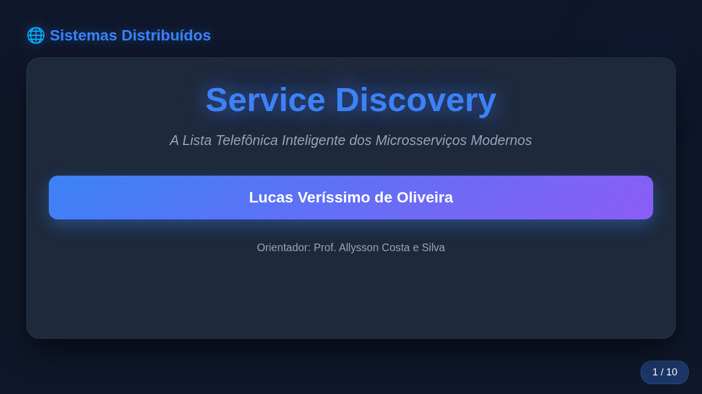
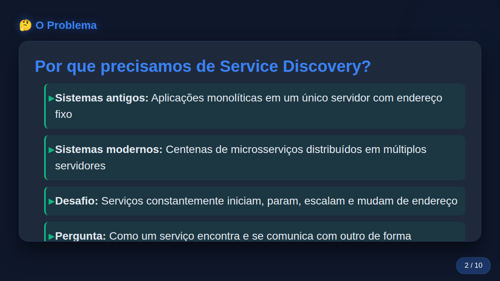
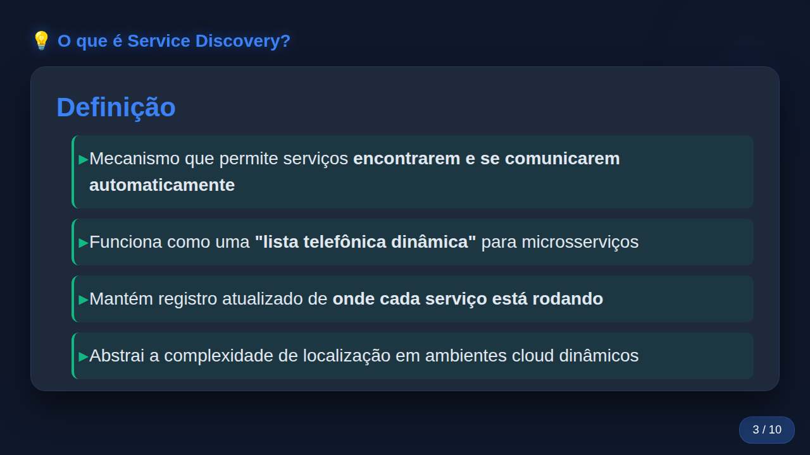
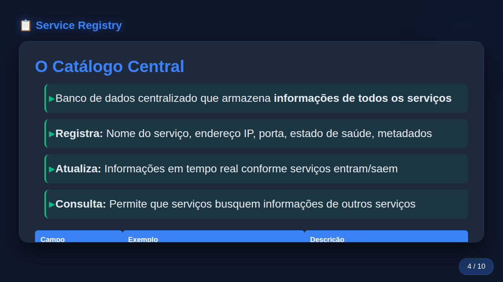
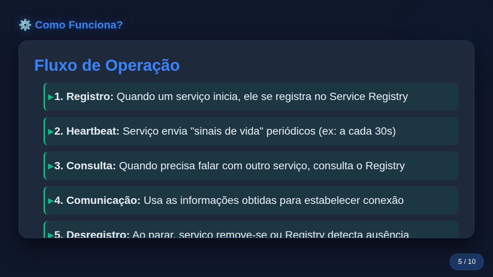
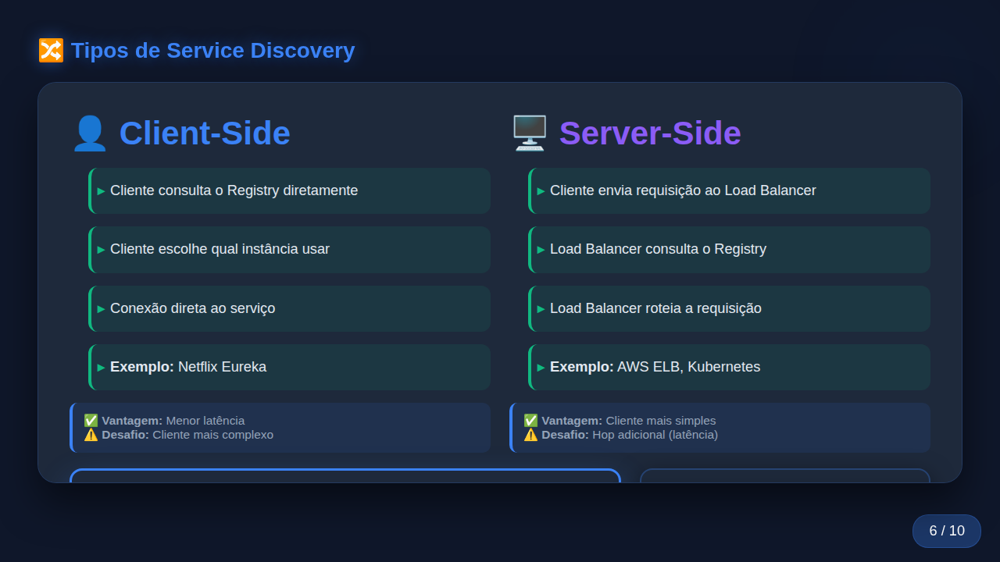
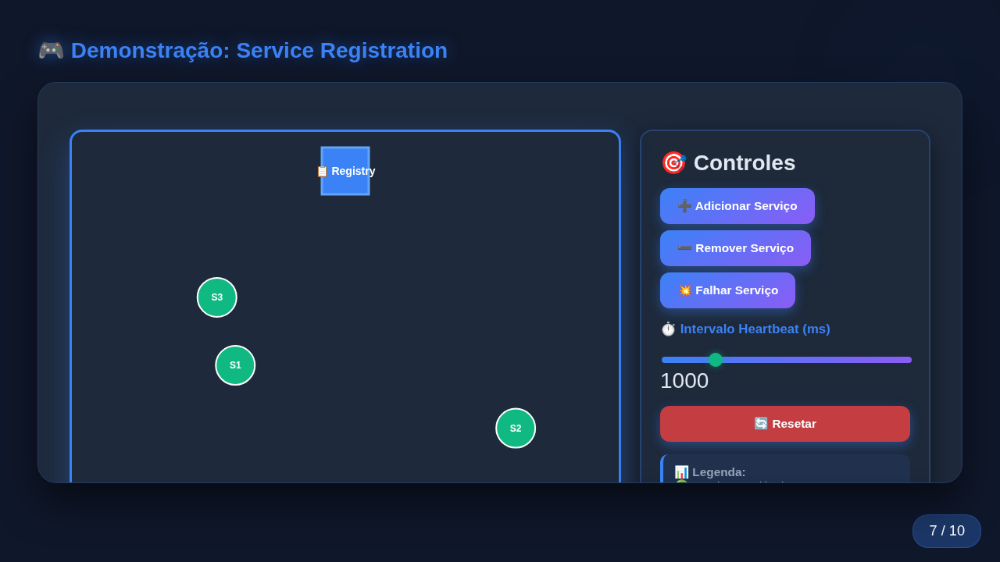
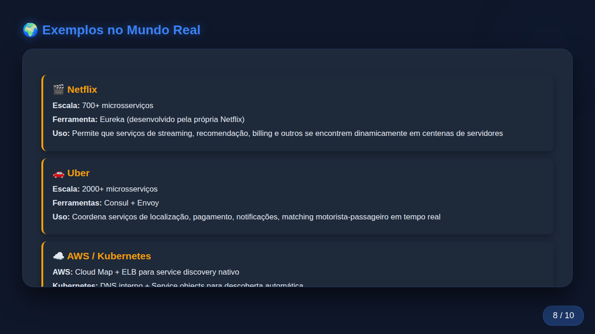
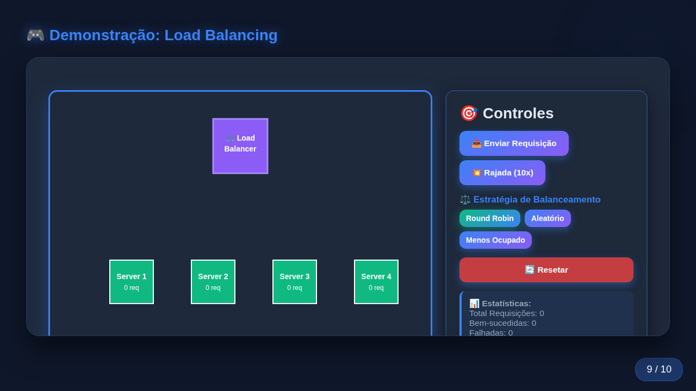
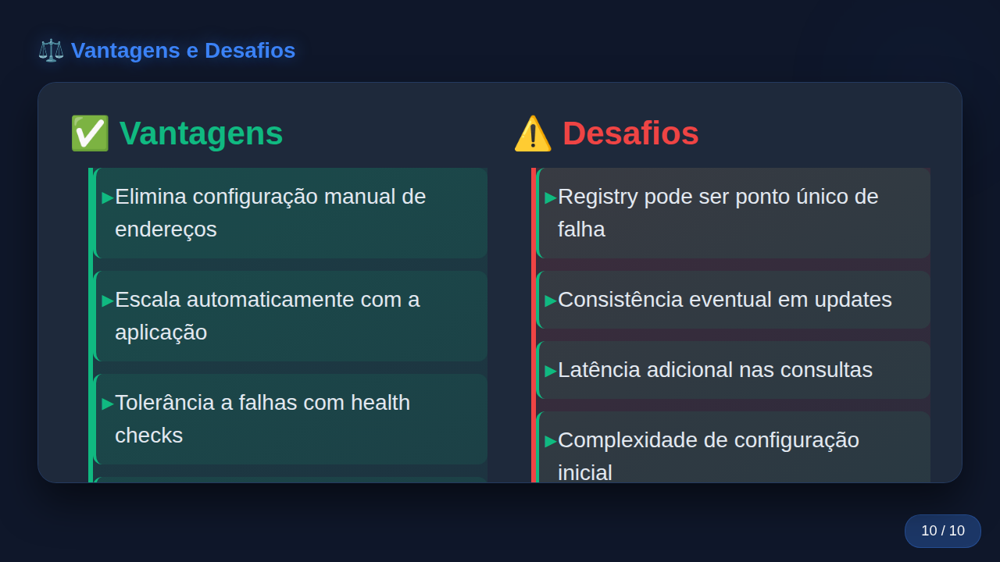

# Service Discovery Presentation 🌐

> An interactive web-based presentation on Service Discovery in modern distributed systems and microservices architectures.

---

## Repository Description Suggestions 📝

If you need a short description for your GitHub repository, here are a few options:

* **Short & Direct:** Interactive web presentation and visual demonstrations on Service Discovery in Microservices.
* **Detailed:** A comprehensive, interactive slide deck covering Service Discovery mechanisms, Service Registries, Client-Side vs. Server-Side discovery, and Load Balancing in distributed systems.
* **Portuguese:** Apresentação interativa sobre Service Discovery em arquiteturas de microsserviços e sistemas distribuídos.

---

## Table of Contents

- [English Version](#english)
  - [About the Project](#about-the-project)
  - [Topics Covered](#topics-covered)
  - [Interactive Features](#interactive-features)
  - [How to Run / Open](#how-to-run--open)
  - [Slide Demonstration](#slide-demonstration)
  - [Credits](#credits)
- [Versão em Português](#versão-em-português)
  - [Sobre o Projeto](#sobre-o-projeto)
  - [Tópicos Abordados](#tópicos-abordados)
  - [Recursos Interativos](#recursos-interativos)
  - [Como Abrir e Executar](#como-abrir-e-executar)
  - [Demonstração dos Slides](#demonstração-dos-slides)
  - [Créditos](#créditos)

---

<a name="english"></a>
## 🇺🇸 English

### About the Project

This project contains an interactive, web-based presentation detailing the concepts, operation, and importance of **Service Discovery** in modern distributed systems and microservices architectures.

As software moves from monolithic applications to hundreds of dynamic microservices scaling in the cloud, locating service endpoints statically becomes impossible. This presentation explains how Service Discovery serves as an intelligent "phone book" for modern microservices.

### Topics Covered

1. **The Problem:** Monolithic vs. modern dynamic microservices architecture and service endpoint challenges.
2. **What is Service Discovery:** Core concepts, abstraction, and dynamic lookup analogies.
3. **Service Registry:** Centralized catalog storing IP addresses, ports, health statuses, and metadata.
4. **How It Works:** Registration, heartbeats, querying, dynamic communication, and deregistration/failure detection.
5. **Client-Side vs. Server-Side Discovery:** Architectural trade-offs, pattern comparisons, and latency differences.
6. **Real-World Examples:** Architecture implementations in Netflix (Eureka), Uber (Consul + Envoy), AWS (Cloud Map), and Kubernetes (CoreDNS/Services).
7. **Load Balancing Strategies:** Round Robin, Random, and Least Connections.
8. **Trade-offs:** Advantages (automatic scaling, fault tolerance, zero-downtime deployments) vs. Challenges (single point of failure, eventual consistency, network latency).

### Interactive Features

The HTML presentation includes interactive visual animations rendered on HTML5 Canvas:
- **Client-Side vs. Server-Side Simulation:** Visualizes request flow and registry lookups in real-time.
- **Service Registration & Heartbeat Simulator:** Add, remove, or fail services dynamically and watch heartbeat checks in action.
- **Load Balancer Simulator:** Send requests or request bursts using different load balancing strategies (Round Robin, Random, Least Connections).

### How to Run / Open

No build step or complex dependencies are required!

1. **Clone the repository:**
   ```bash
   git clone https://github.com/lucasverissimo159/discovery_service_presentation.git
   cd discovery_service_presentation
   ```
2. **Open in any modern web browser:**
   - Double-click `discovery_service.html` or open it directly in Chrome, Firefox, Edge, or Safari.
   - Alternatively, serve via a local HTTP server:
     ```bash
     python3 -m http.server 8000
     ```
     Then navigate to `http://localhost:8000/discovery_service.html`.

3. **Navigation Controls:**
   - **Right Arrow / Space / Page Down:** Next slide
   - **Left Arrow / Page Up:** Previous slide
   - **Home / End:** First / Last slide

---

### Slide Demonstration

#### Slide 1: Cover Page


#### Slide 2: The Problem


#### Slide 3: What is Service Discovery?


#### Slide 4: Service Registry


#### Slide 5: How It Works


#### Slide 6: Client-Side vs Server-Side Discovery


#### Slide 7: Interactive Demo - Service Registration


#### Slide 8: Real-World Examples


#### Slide 9: Interactive Demo - Load Balancing


#### Slide 10: Advantages & Challenges


---

### Credits

- **Author:** Lucas Veríssimo de Oliveira
- **Advisor:** Prof. Allysson Costa e Silva
- **Subject:** Distributed Systems (Sistemas Distribuídos)

---

<a name="versão-em-português"></a>
## 🇧🇷 Português

### Sobre o Projeto

Este projeto consiste em uma apresentação web interativa que detalha os conceitos, o funcionamento e a importância do **Service Discovery** em sistemas distribuídos e arquiteturas de microsserviços modernas.

Com a evolução dos sistemas monolíticos para centenas de microsserviços dinâmicos executados em nuvem, torna-se inviável gerenciar endereços de rede de forma estática. Esta apresentação explica como o Service Discovery atua como uma "lista telefônica inteligente" para os microsserviços.

### Tópicos Abordados

1. **O Problema:** Diferenças entre sistemas monolíticos e microsserviços dinâmicos, e o desafio do endereçamento de rede.
2. **O que é Service Discovery:** Conceito, abstração e analogia com listas telefônicas dinâmicas.
3. **Service Registry:** O catálogo central de serviços, armazenando IPs, portas, estados de saúde e metadados.
4. **Fluxo de Funcionamento:** Registro, sinais de vida (*heartbeats*), consultas, comunicação e desregistro/detecção de falhas.
5. **Client-Side vs. Server-Side Discovery:** Comparativo de arquiteturas, vantagens, desvantagens e latência.
6. **Exemplos no Mundo Real:** Casos práticos da Netflix (Eureka), Uber (Consul + Envoy), AWS (Cloud Map) e Kubernetes (CoreDNS/Services).
7. **Estratégias de Balanceamento de Carga:** Round Robin, Aleatório e Menos Ocupado (*Least Connections*).
8. **Vantagens e Desafios:** Escalabilidade automática, tolerância a falhas, *deploy* sem downtime versus ponto único de falha e consistência eventual.

### Recursos Interativos

A apresentação foi desenvolvida em HTML/CSS/JavaScript puro com simulações interativas em HTML5 Canvas:
- **Simulador Client-Side vs. Server-Side:** Visualização interativa do fluxo de requisições.
- **Simulador de Registro e Heartbeat:** Permite adicionar, remover ou simular falhas em serviços para observar a reação do Service Registry.
- **Simulador de Load Balancing:** Envio de requisições individuais ou em rajadas com diferentes algoritmos de distribuição de carga.

### Como Abrir e Executar

Não é necessária nenhuma instalação ou compilação!

1. **Clone o repositório:**
   ```bash
   git clone https://github.com/lucasverissimo159/discovery_service_presentation.git
   cd discovery_service_presentation
   ```
2. **Abra em qualquer navegador web moderno:**
   - Dê um duplo clique no arquivo `discovery_service.html` ou abra-o diretamente no Chrome, Firefox, Edge ou Safari.
   - Caso prefira, utilize um servidor HTTP local:
     ```bash
     python3 -m http.server 8000
     ```
     Acesse no navegador: `http://localhost:8000/discovery_service.html`.

3. **Teclas de Atalho:**
   - **Seta para Direita / Espaço / Page Down:** Próximo slide
   - **Seta para Esquerda / Page Up:** Slide anterior
   - **Home / End:** Primeiro / Último slide

---

### Demonstração dos Slides

#### Slide 1: Capa da Apresentação


#### Slide 2: O Problema


#### Slide 3: O que é Service Discovery


#### Slide 4: Service Registry


#### Slide 5: Como Funciona


#### Slide 6: Client-Side vs Server-Side Discovery


#### Slide 7: Demonstração Interativa - Registro de Serviços


#### Slide 8: Exemplos no Mundo Real


#### Slide 9: Demonstração Interativa - Balanceamento de Carga


#### Slide 10: Vantagens e Desafios


---

### Créditos

- **Autor:** Lucas Veríssimo de Oliveira
- **Orientador:** Prof. Allysson Costa e Silva
- **Disciplina:** Sistemas Distribuídos
